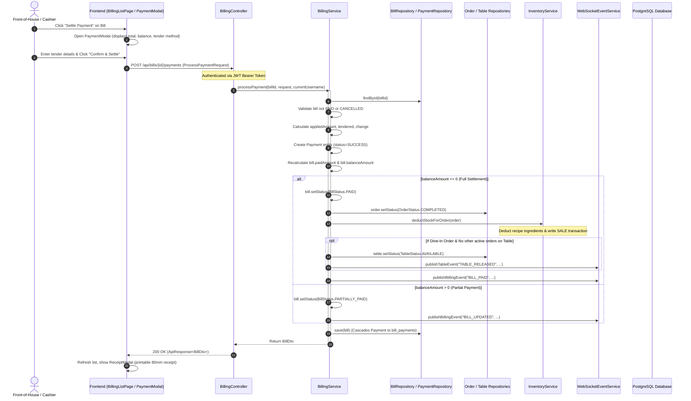

# Comprehensive Technical Audit: Restro POS Architecture & Stripe Payment Integration

**Target System:** Restro POS (Enterprise Restaurant Management System)  
**Client Jurisdiction:** Singapore (SGD Currency, GST compliant)  
**Auditor:** Senior Software Architect (Java Spring Boot, React TypeScript, PostgreSQL, Stripe Payments)  
**Date:** October 2026  
**Audit Mode:** Read-Only Static & Structural Inspection  

---

## 1. Executive Summary

A comprehensive architectural and code audit of the **Restro POS** repository was conducted to assess the readiness of the application for production Stripe Checkout integration. The application is a multi-outlet, enterprise-grade restaurant point-of-sale platform featuring table management, menu engineering, kitchen display workflows (KDS), inventory recipe deduction, and billing/tax invoicing.

### Key Audit Findings:
1. **Established & Solid Billing Core:** The core backend billing infrastructure is implemented in [BillingController.java](file:///d:/novahomotech/Enterprise-Restaurant-Management-System/backend/src/main/java/com/example/restaurant/controller/BillingController.java), [BillingService.java](file:///d:/novahomotech/Enterprise-Restaurant-Management-System/backend/src/main/java/com/example/restaurant/service/BillingService.java), and [Payment.java](file:///d:/novahomotech/Enterprise-Restaurant-Management-System/backend/src/main/java/com/example/restaurant/entity/Payment.java). It cleanly orchestrates partial payments, order completion, table status release, inventory recipe deduction, and real-time WebSocket notifications.
2. **Zero Prior Stripe Dependencies:** Neither backend (`backend/pom.xml`) nor frontend (`frontend/package.json`) contains Stripe SDKs or references. No third-party gateway integrations (Stripe, Razorpay, PayPal) currently exist.
3. **Legacy V1 Invoicing vs V6 Billing Dualism:** The initial Flyway migration ([V1__init_schema.sql](file:///d:/novahomotech/Enterprise-Restaurant-Management-System/backend/src/main/resources/db/migration/V1__init_schema.sql)) defined legacy tables (`invoices`, `payments`, `payment_transactions`, `refunds`), but these were completely superseded in [V6__billing_and_payments.sql](file:///d:/novahomotech/Enterprise-Restaurant-Management-System/backend/src/main/resources/db/migration/V6__billing_and_payments.sql) by `bills`, `bill_items`, and `bill_payments`, and in [V7__inventory_purchasing_refunds.sql](file:///d:/novahomotech/Enterprise-Restaurant-Management-System/backend/src/main/resources/db/migration/V7__inventory_purchasing_refunds.sql) by `refund_transactions`. All JPA entities and REST controllers operate exclusively on the `bills` and `bill_payments` schema.
4. **PaymentStatus Enum Gap:** The existing [PaymentStatus.java](file:///d:/novahomotech/Enterprise-Restaurant-Management-System/backend/src/main/java/com/example/restaurant/entity/PaymentStatus.java) contains only `SUCCESS`, `REFUNDED`, and `FAILED`. It lacks `PENDING` (vital for asynchronous Stripe Checkout sessions), and [PaymentMethod.java](file:///d:/novahomotech/Enterprise-Restaurant-Management-System/backend/src/main/java/com/example/restaurant/entity/PaymentMethod.java) lacks `STRIPE`.
5. **Customer Portal Client-Side Simulation:** While the staff POS and Billing pages ([BillingListPage.tsx](file:///d:/novahomotech/Enterprise-Restaurant-Management-System/frontend/src/pages/billing/BillingListPage.tsx), [PaymentModal.tsx](file:///d:/novahomotech/Enterprise-Restaurant-Management-System/frontend/src/pages/billing/PaymentModal.tsx)) communicate with real Spring Boot backend endpoints, the public customer portal ([CustomerCheckoutPage.tsx](file:///d:/novahomotech/Enterprise-Restaurant-Management-System/frontend/src/pages/customer/CustomerCheckoutPage.tsx), [PaymentGatewayModal.tsx](file:///d:/novahomotech/Enterprise-Restaurant-Management-System/frontend/src/components/customer/checkout/PaymentGatewayModal.tsx)) persists orders and mock payments in browser `localStorage`.
6. **Security & Webhook Readiness:** Spring Security ([SecurityConfig.java](file:///d:/novahomotech/Enterprise-Restaurant-Management-System/backend/src/main/java/com/example/restaurant/config/SecurityConfig.java)) uses stateless JWT and disables CSRF. However, inbound webhook endpoints (e.g. `/api/payments/stripe/webhook`) are currently not exempted from authentication, and raw-body verification for Stripe signatures must be introduced.

---

## 2. Technology Stack & Runtime Configuration

Inspection of build descriptors and configuration files identified the following verified specifications:

| Component | Verified Specification | Source File / Descriptor |
| :--- | :--- | :--- |
| **Backend Framework** | Spring Boot `3.3.4` | [backend/pom.xml](file:///d:/novahomotech/Enterprise-Restaurant-Management-System/backend/pom.xml#L10) |
| **Java Platform** | Java `21` (LTS) | [backend/pom.xml](file:///d:/novahomotech/Enterprise-Restaurant-Management-System/backend/pom.xml#L21), [.java-version](file:///d:/novahomotech/Enterprise-Restaurant-Management-System/.java-version) |
| **Database Migration** | Flyway Core `10.x` (`flyway-database-postgresql`) | [backend/pom.xml](file:///d:/novahomotech/Enterprise-Restaurant-Management-System/backend/pom.xml#L61-L67) |
| **Primary Database** | PostgreSQL 16 (H2 fallback for dev unit tests) | [application-dev.yml](file:///d:/novahomotech/Enterprise-Restaurant-Management-System/backend/src/main/resources/application-dev.yml#L3-L6), [DatabaseConfig.java](file:///d:/novahomotech/Enterprise-Restaurant-Management-System/backend/src/main/java/com/example/restaurant/config/DatabaseConfig.java#L21-L81) |
| **Frontend Framework** | React `18.3.1` + React DOM `18.3.1` | [frontend/package.json](file:///d:/novahomotech/Enterprise-Restaurant-Management-System/frontend/package.json#L22-L23) |
| **Frontend Language** | TypeScript `5.6.3` | [frontend/package.json](file:///d:/novahomotech/Enterprise-Restaurant-Management-System/frontend/package.json#L40) |
| **Bundler & Dev Server**| Vite `5.4.8` | [frontend/package.json](file:///d:/novahomotech/Enterprise-Restaurant-Management-System/frontend/package.json#L41) |
| **UI State & Querying** | TanStack React Query `5.59.0`, Axios `1.7.7` | [frontend/package.json](file:///d:/novahomotech/Enterprise-Restaurant-Management-System/frontend/package.json#L17-L18) |
| **WebSockets (STOMP)** | `@stomp/stompjs` `7.0.0`, `sockjs-client` `1.6.1` | [frontend/package.json](file:///d:/novahomotech/Enterprise-Restaurant-Management-System/frontend/package.json#L16-L27) |
| **Deployment Manifests**| Dockerfile (Multi-stage Eclipse Temurin 21) & `render.yaml` | [Dockerfile](file:///d:/novahomotech/Enterprise-Restaurant-Management-System/Dockerfile), [render.yaml](file:///d:/novahomotech/Enterprise-Restaurant-Management-System/render.yaml) |

---

## 3. Existing Project Structure & Component Directory

```
Enterprise-Restaurant-Management-System/
├── backend/
│   ├── pom.xml                                  # Maven dependencies (Java 21, Spring Boot 3.3.4)
│   ├── Dockerfile                               # Multi-stage JDK 21 build container
│   ├── src/main/java/com/example/restaurant/
│   │   ├── config/                              # SecurityConfig, DatabaseConfig, WebSocketConfig, DataInitializer
│   │   ├── controller/                          # BillingController, RefundController, OrderController, etc.
│   │   ├── dto/                                 # billing/, order/, inventory/, response/, auth/
│   │   ├── entity/                              # Bill, Payment, BillItem, Order, RefundTransaction, Enums
│   │   ├── repository/                          # BillRepository, PaymentRepository, RefundRepository, OrderRepository
│   │   ├── security/                            # JwtTokenProvider, JwtAuthenticationFilter, UserPrincipal
│   │   └── service/                             # BillingService, RefundService, OrderService, InventoryService
│   └── src/main/resources/
│       ├── application.yml                      # Base configuration, JWT, CORS, Swagger
│       ├── application-dev.yml                  # Local development profile (H2 PostgreSQL mode)
│       ├── application-prod.yml                 # Render production profile (PostgreSQL datasource)
│       └── db/migration/                        # Flyway V1 through V7 SQL migration scripts
├── frontend/
│   ├── package.json                             # React 18, Vite 5, Tailwind CSS, TanStack Query
│   ├── vite.config.js                           # Vite configuration with @/ alias
│   └── src/
│       ├── api/                                 # client.ts (Axios), billing.ts, order.ts, websocket.ts
│       ├── components/                          # Layout, Common (Button, Modal, StatCard), Customer
│       ├── context/                             # AuthContext, CustomerContext, CustomerCartContext
│       ├── hooks/                               # useWebSocketSync, useCustomerOrders
│       ├── layouts/                             # AppLayout (Sidebar, Topbar)
│       ├── pages/
│       │   ├── billing/                         # BillingListPage, PaymentModal, ReceiptModal
│       │   ├── orders/                          # OrderListPage, OrderDetailModal
│       │   ├── pos/                             # PosPage, ModifierModal, DiscountModal
│       │   ├── customer/                        # CustomerCheckoutPage, CustomerMenuPage, CustomerOrdersPage
│       │   └── refunds/                         # RefundListPage
│       └── types/                               # billing.ts, order.ts, api.ts, customer.ts
├── database/                                    # schema.sql, seed.sql
├── docs/                                        # Existing architecture & business documentation
└── render.yaml                                  # Render Blueprint deployment definition
```

---

## 4. Detailed Component & Class Analysis

### 4.1 Billing & Payment Domain Classes

#### 1. `Bill.java` ([Bill.java](file:///d:/novahomotech/Enterprise-Restaurant-Management-System/backend/src/main/java/com/example/restaurant/entity/Bill.java))
- **Table:** `bills`
- **Fields:** `id` (UUID string), `outlet` (`@ManyToOne Outlet`), `order` (`@ManyToOne Order`), `billNumber` (`VARCHAR(30)` unique), `subtotal`, `taxAmount`, `discountAmount`, `totalAmount`, `paidAmount`, `balanceAmount`, `status` (`BillStatus`), `notes`, `items` (`List<BillItem>`), `payments` (`List<Payment>`), timestamps.
- **Responsibilities:** Authoritative master ledger for a customer order ticket. Maintains strict monetary balance: `balanceAmount = totalAmount - paidAmount`.

#### 2. `Payment.java` ([Payment.java](file:///d:/novahomotech/Enterprise-Restaurant-Management-System/backend/src/main/java/com/example/restaurant/entity/Payment.java))
- **Table:** `bill_payments`
- **Fields:** `id` (UUID string), `bill` (`@ManyToOne Bill`), `outlet` (`@ManyToOne Outlet`), `paymentMethod` (`PaymentMethod`), `amount` (`BigDecimal`), `tenderedAmount`, `changeAmount`, `transactionRef` (`VARCHAR(100)`), `status` (`PaymentStatus`), `notes`, `createdBy` (`@ManyToOne User`), `createdAt`.
- **Responsibilities:** Individual tender record. Allows split payments (e.g. partial cash + partial card).
- **Critical Audit Note:** Initial status defaults to `PaymentStatus.SUCCESS` upon creation. Lacks fields for Stripe Checkout session ID, Stripe payment intent ID, and currency.

#### 3. `RefundTransaction.java` ([RefundTransaction.java](file:///d:/novahomotech/Enterprise-Restaurant-Management-System/backend/src/main/java/com/example/restaurant/entity/RefundTransaction.java))
- **Table:** `refund_transactions`
- **Fields:** `id`, `payment` (`@ManyToOne Payment`), `amount`, `reason`, `status` (`COMPLETED`), `createdBy`, `createdAt`.
- **Responsibilities:** Records reversals against settled `bill_payments`.

#### 4. Enums
- **`PaymentMethod.java`** ([PaymentMethod.java](file:///d:/novahomotech/Enterprise-Restaurant-Management-System/backend/src/main/java/com/example/restaurant/entity/PaymentMethod.java)): Values: `CASH`, `CARD`, `UPI`, `WALLET`. **Missing:** `STRIPE` (or `STRIPE_CHECKOUT`).
- **`PaymentStatus.java`** ([PaymentStatus.java](file:///d:/novahomotech/Enterprise-Restaurant-Management-System/backend/src/main/java/com/example/restaurant/entity/PaymentStatus.java)): Values: `SUCCESS`, `REFUNDED`, `FAILED`. **Missing:** `PENDING`, `CANCELLED`, `EXPIRED`.
- **`BillStatus.java`** ([BillStatus.java](file:///d:/novahomotech/Enterprise-Restaurant-Management-System/backend/src/main/java/com/example/restaurant/entity/BillStatus.java)): Values: `UNPAID`, `PARTIALLY_PAID`, `PAID`, `CANCELLED`. Complete and fully suitable for Stripe reconciliation.

---

## 5. Current Bill-to-Payment Execution Flow

The existing workflow from order capture to payment settlement and post-payment side-effects operates as follows:



### Detailed Side-Effect Audit:
- **Order State Transition:** In `BillingService.java#L201-205`, when `balanceAmount <= 0`, the associated `Order` is automatically marked `OrderStatus.COMPLETED`.
- **Inventory Deduction Idempotency:** In `InventoryService.java#L116-165`, stock for all recipe items linked to the order items is deducted. It already includes an idempotency safeguard: `inventoryTransactionRepository.existsByReferenceIdAndTransactionType(order.getId(), InventoryTransactionType.SALE)`.
- **Table Release:** In `BillingService.java#L210-224`, if the order is `DINE_IN` and has no other active orders, the table status transitions from `BILLING` to `AVAILABLE`.
- **WebSocket Broadcast:** `WebSocketEventService.java#L35-37` publishes `BILL_PAID` to `/topic/billing`. The frontend hook `useWebSocketSync.ts#L36-42` catches this event and immediately invalidates TanStack queries `['bills']`, `['reports']`, and `['dashboard-stats']`.

---

## 6. Existing Database Schema & Migration Review

Flyway migrations are located in `backend/src/main/resources/db/migration/`:

| Version | Script Name | Billing / Payment Relevance |
| :--- | :--- | :--- |
| `V1` | `V1__init_schema.sql` | Contains initial DDL for `orders`, `order_items`, `kots`, `kot_items`, and legacy `invoices`, `payments`, `payment_transactions`, `refunds`. |
| `V2` | `V2__auth_and_rbac_tables.sql` | RBAC tables (`roles`, `permissions`, `users`). Seeds billing permissions `BILL_VIEW`, `BILL_CREATE`, `PAYMENT_CREATE`, `PAYMENT_REFUND`. |
| `V3` | `V3__menu_modifiers.sql` | Menu modifier tables. |
| `V4` | `V4__order_item_modifiers.sql` | Order item modifier linking. |
| `V5` | `V5__kds_enhancements.sql` | Kitchen stations and item status tracking. |
| `V6` | `V6__billing_and_payments.sql` | **Active Billing Tables:** `bills`, `bill_items`, `bill_payments`. Creates performance indexes on `(outlet_id, status)` and `(bill_id)`. |
| `V7` | `V7__inventory_purchases.sql` | Purchase orders and active `refund_transactions` table linked to `bill_payments(id)`. |

### Database Schema Table Inspection:
- **`bills`:**
  - `id VARCHAR(36) PRIMARY KEY`
  - `outlet_id VARCHAR(36) NOT NULL REFERENCES outlets(id)`
  - `order_id VARCHAR(36) NOT NULL REFERENCES orders(id)`
  - `bill_number VARCHAR(30) NOT NULL UNIQUE`
  - `subtotal DECIMAL(10,2)`, `tax_amount DECIMAL(10,2)`, `discount_amount DECIMAL(10,2)`, `total_amount DECIMAL(10,2)`
  - `paid_amount DECIMAL(10,2)`, `balance_amount DECIMAL(10,2)`
  - `status VARCHAR(20) NOT NULL DEFAULT 'UNPAID'`
  - `notes TEXT`, `created_at TIMESTAMP`, `updated_at TIMESTAMP`
- **`bill_payments`:**
  - `id VARCHAR(36) PRIMARY KEY`
  - `bill_id VARCHAR(36) NOT NULL REFERENCES bills(id) ON DELETE CASCADE`
  - `outlet_id VARCHAR(36) NOT NULL REFERENCES outlets(id)`
  - `payment_method VARCHAR(20) NOT NULL` (Currently: `CASH`, `CARD`, `UPI`, `WALLET`)
  - `amount DECIMAL(10,2) NOT NULL`
  - `tendered_amount DECIMAL(10,2)`, `change_amount DECIMAL(10,2)`
  - `transaction_ref VARCHAR(100)`
  - `status VARCHAR(20) NOT NULL DEFAULT 'SUCCESS'`
  - `notes TEXT`, `created_by VARCHAR(36) REFERENCES users(id)`, `created_at TIMESTAMP`

---

## 7. Security, Permissions, CORS, and Secret Architecture

### 7.1 Spring Security ([SecurityConfig.java](file:///d:/novahomotech/Enterprise-Restaurant-Management-System/backend/src/main/java/com/example/restaurant/config/SecurityConfig.java))
- **Session Policy:** `SessionCreationPolicy.STATELESS` with JWT bearer validation via `JwtAuthenticationFilter`.
- **CSRF:** Disabled (`AbstractHttpConfigurer::disable`) — standard for token-based APIs.
- **CORS:** Configured via `CorsConfigurationSource`:
  - `allowedOriginPatterns: ["*"]`
  - Allowed headers: `Authorization`, `Content-Type`, `X-Outlet-Id`, `Accept`, `Origin`, `X-Requested-With`
  - `allowCredentials: true`
- **Method Security:** `@EnableMethodSecurity` active. Endpoints in `BillingController` require authorities:
  - `BILL_CREATE`, `ORDER_UPDATE`, `ADMIN` for bill generation.
  - `BILL_VIEW`, `ORDER_VIEW`, `ADMIN` for bill viewing.
  - `PAYMENT_CREATE`, `BILL_CREATE`, `ADMIN` for payment processing.

### 7.2 Webhook Security Audit
- Stripe webhooks send HTTP `POST` requests directly from Stripe cloud IP ranges without JWT credentials.
- **Vulnerability:** Under current `SecurityConfig.java#L51-66`, any path not explicitly permitted under `requestMatchers(...)` defaults to `anyRequest().authenticated()`.
- **Requirement:** `/api/payments/stripe/webhook` must be added to `.requestMatchers(HttpMethod.POST, "/api/payments/stripe/webhook").permitAll()`.
- **Request Body Caching Requirement:** Stripe webhook signature verification (`Webhook.constructEvent(payload, sigHeader, secret)`) requires the verbatim raw request byte stream. Spring's standard `@RequestBody String payload` can alter line breaks or whitespace in certain character sets, which can cause signature validation to fail. A dedicated raw-body reading mechanism or filter is required.

### 7.3 Secrets & Environment Configuration Audit
- **Backend Configuration:** [application.yml](file:///d:/novahomotech/Enterprise-Restaurant-Management-System/backend/src/main/resources/application.yml) binds environment variables with fallback defaults (e.g. `JWT_SECRET`, `PORT`, `CORS_ORIGINS`).
- **Secret Hygiene Check:** No hardcoded Stripe keys exist in the repository.
- **Frontend Configuration:** [frontend/.env.development](file:///d:/novahomotech/Enterprise-Restaurant-Management-System/frontend/.env.development) contains only `VITE_API_BASE_URL` and `VITE_WS_URL`.
- **Requirement:** Stripe Secret Key (`STRIPE_SECRET_KEY`) and Webhook Signing Secret (`STRIPE_WEBHOOK_SECRET`) must reside exclusively on the backend. The frontend will only receive the Stripe Checkout redirection URL (or `STRIPE_PUBLISHABLE_KEY` if Stripe Elements or Stripe.js is embedded).

---

## 8. Currency & Singapore Merchant Localization

- **Current Currency Configuration:**
  - `SettingService.java#L46-47` defaults `currency` to `"USD"` and `currency_symbol` to `"$"` if not configured for the outlet.
  - `DataInitializer.java` seeds outlet `"OUT-001"` with a US tax number (`TAX-US-892110`).
  - Frontend receipts and labels format amounts with `$` (`ReceiptModal.tsx#L102`, `PaymentModal.tsx#L111`).
- **Singapore Requirements:**
  - Currency code: `SGD` (Stripe requires lowercase `"sgd"` in session creation).
  - Stripe Checkout converts decimal currencies into smallest integer units: `1 SGD = 100 cents`. For example, a bill total of `$25.50` must be submitted to Stripe as `2550` units.
  - Singapore GST: Current GST in Singapore is 9%. The existing `taxes` table and `Bill.taxAmount` already support configurable percentage rates and can cleanly represent Singapore GST.

---

## 9. Reusable Classes vs Missing Functionality

### 9.1 Reusable Classes & Methods (Do NOT Reinvent)
- `BillingService.java`:
  - `getBillById(String id)`: Authoritative balance retrieval.
  - `generateBillForOrder(String orderId)`: Bill generation and sync.
  - Order completion, table release, and WebSocket broadcast logic inside `processPayment(...)`.
- `InventoryService.java#deductStockForOrder(Order)`: Production-ready, idempotent recipe ingredient stock deduction.
- `WebSocketEventService.java#publishBillingEvent`: Notifies POS of payment events.
- `ReceiptModal.tsx`: Reads `bill.payments` dynamically and prints payments regardless of method.
- `client.ts`: Axios client handling auth tokens, refresh tokens, and `X-Outlet-Id`.

### 9.2 Missing Functionality & Deficiencies
1. **Missing Stripe SDK:** `backend/pom.xml` lacks `com.stripe:stripe-java`.
2. **Missing Payment Status `PENDING`:** When a checkout session is initiated, the bill payment must enter a `PENDING` state to avoid double-charging or race conditions.
3. **Missing Payment Method `STRIPE`:** Neither `PaymentMethod.java` nor frontend `PaymentMethod` type includes `STRIPE`.
4. **Missing Stripe Metadata Fields in Schema:** No columns exist in `bill_payments` for `stripe_session_id`, `stripe_payment_intent_id`, or `currency`.
5. **Missing Webhook Idempotency Store:** No table exists to record received Stripe event IDs (`evt_...`) to guarantee idempotency against duplicate webhook deliveries.
6. **Customer Portal Disconnect:** Customer checkout currently relies on mock `localStorage` orders instead of the Spring Boot backend billing pipeline.

---

## 10. Potential Conflicting Implementations & Dualism

1. **Legacy `invoices` vs Active `bills` Table:**
   - [V1__init_schema.sql](file:///d:/novahomotech/Enterprise-Restaurant-Management-System/backend/src/main/resources/db/migration/V1__init_schema.sql#L213-L250) has `invoices`, `payments`, `payment_transactions`, `refunds`.
   - [V6__billing_and_payments.sql](file:///d:/novahomotech/Enterprise-Restaurant-Management-System/backend/src/main/resources/db/migration/V6__billing_and_payments.sql#L5-L49) has `bills`, `bill_items`, `bill_payments`.
   - **Resolution:** The Stripe integration MUST integrate strictly with `bills` and `bill_payments`. The legacy V1 tables must be left untouched to avoid breaking legacy migration integrity, but no new code should touch them.
2. **Payment Processing Status Default:**
   - In `Payment.java#L70`, `this.status = PaymentStatus.SUCCESS;` is hardcoded in the constructor. For Stripe Checkout, payment records must be instantiated with `PaymentStatus.PENDING`.

---

## 11. Exact Files to Modify vs New Files Needed

### Existing Files That Must Be Modified:
1. `backend/pom.xml`: Add official `stripe-java` dependency.
2. `backend/src/main/resources/application.yml`: Add Stripe configuration properties (`stripe.api-key`, `stripe.webhook-secret`, `stripe.currency`).
3. `backend/src/main/java/com/example/restaurant/entity/PaymentMethod.java`: Add `STRIPE`.
4. `backend/src/main/java/com/example/restaurant/entity/PaymentStatus.java`: Add `PENDING`, `CANCELLED`, `EXPIRED`.
5. `backend/src/main/java/com/example/restaurant/entity/Payment.java`: Add `stripeSessionId`, `stripePaymentIntentId`, `currency` fields and getter/setters.
6. `backend/src/main/java/com/example/restaurant/repository/PaymentRepository.java`: Add query methods `findByStripeSessionId(String sessionId)` and `findByStripePaymentIntentId(String intentId)`.
7. `backend/src/main/java/com/example/restaurant/config/SecurityConfig.java`: Permit anonymous `POST /api/payments/stripe/webhook`.
8. `backend/src/main/java/com/example/restaurant/service/BillingService.java`: Refactor settlement logic into a reusable method callable by both manual payment and Stripe webhook callbacks.
9. `frontend/src/types/billing.ts`: Update `PaymentMethod` to include `'STRIPE'` and `PaymentStatus` to include `'PENDING' | 'CANCELLED' | 'EXPIRED'`.
10. `frontend/src/pages/billing/PaymentModal.tsx`: Add "Stripe Online" option with "Launch Stripe Checkout" button and live payment status listener.
11. `frontend/src/api/billing.ts`: Add `createStripeCheckoutSession(billId)` API call.

### New Files Genuine & Necessary:
1. `backend/src/main/resources/db/migration/V8__stripe_payment_integration.sql`: Flyway migration adding Stripe columns to `bill_payments` and creating `stripe_webhook_events` idempotency table.
2. `backend/src/main/java/com/example/restaurant/config/StripeConfig.java`: Configuration bean reading Stripe API keys from Spring properties and initializing Stripe SDK.
3. `backend/src/main/java/com/example/restaurant/dto/billing/StripeCheckoutSessionResponse.java`: Response DTO returning `sessionId`, `sessionUrl`, `publishableKey`.
4. `backend/src/main/java/com/example/restaurant/entity/StripeWebhookEvent.java`: Entity for tracking processed webhook IDs (`evt_...`).
5. `backend/src/main/java/com/example/restaurant/repository/StripeWebhookEventRepository.java`: JPA repository for webhook event deduplication.
6. `backend/src/main/java/com/example/restaurant/service/StripePaymentService.java`: Encapsulates Stripe Checkout Session creation, webhook signature verification, and reconciliation logic.
7. `backend/src/main/java/com/example/restaurant/controller/StripePaymentController.java`: Endpoints for Checkout Session creation (`POST /api/bills/{id}/stripe-checkout`) and inbound webhook processing (`POST /api/payments/stripe/webhook`).
8. `backend/src/test/java/com/example/restaurant/StripePaymentIntegrationTests.java`: Comprehensive MockMvc test suite verifying session creation, signature validation, idempotent webhooks, and bill settlement.
9. `frontend/src/pages/billing/StripeReturnPage.tsx`: Dedicated return landing page displaying live polling/verification while Stripe webhook finalizes the transaction.

---

## 12. Integration Risks & Unresolved Questions

| Risk / Question | Impact | Recommendation / Mitigation | Status |
| :--- | :--- | :--- | :--- |
| **Reverse Proxy / Raw Webhook Body** | High | Render or Spring middleware could modify raw bytes, invalidating Stripe HMAC signature. | Read raw payload string directly in controller or custom filter without Jackson pre-parsing. | Needs verification on deployment |
| **Customer Portal Unification** | Medium | Customer portal currently uses `localStorage` instead of backend `Order` / `Bill`. | Keep staff POS Stripe Checkout as Phase 1 primary priority; unify customer checkout to backend in Phase 2. | Verified |
| **Currency Consistency** | Medium | Settings default to USD while Singapore client uses SGD. | Enforce `SGD` as default in `StripePaymentService` with outlet setting override. | Verified |
| **Partial Payments with Stripe** | Low | Customer wants to pay part in cash, remainder with Stripe. | Supported by design: Stripe Checkout Session is initialized for `bill.getBalanceAmount()`, not total amount. | Verified |
| **Split-Second Concurrent Webhooks** | High | Duplicate delivery of `checkout.session.completed`. | Guard with database unique constraint on `stripe_webhook_events(event_id)` inside serializable/isolated transaction. | Verified |

---

*End of Technical Audit Report.*
