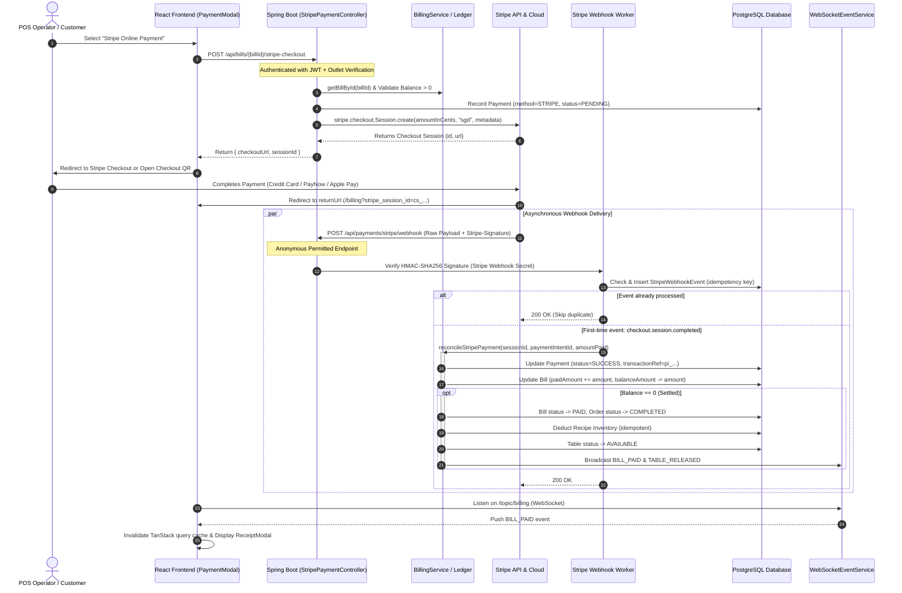

# Architectural Implementation Plan: Stripe Checkout & Webhook Integration

**Project:** Restro POS (Enterprise Restaurant Management System)  
**Target Merchant:** Singapore Restaurant Client (`SGD` Currency)  
**Primary Integration Pattern:** Stripe-Hosted Checkout Session + Idempotent Webhook Finalization  
**Document Location:** `docs/stripe-integration-plan.md`  
**Prerequisite:** Codebase Audit Report (`docs/stripe-integration-audit.md`)  

---

## Architectural Principles & Strict Payment Safeguards

1. **Stripe-Hosted Checkout Exclusivity:** The POS application will not collect, transmit, or store raw credit/debit card numbers or CVVs. All payment collection occurs on Stripe-hosted checkout pages (PCI-DSS SAQ A compliance).
2. **Authoritative Backend Ledger:** The frontend will **never** dictate the payment amount, currency, or bill status. The amount sent to Stripe is computed strictly from `bill.getBalanceAmount()` on the backend.
3. **Webhook-Driven State Finalization:** A bill is **never** marked as paid simply because the user's browser redirected to a success URL. The definitive state transition occurs exclusively upon receiving a cryptographically verified `checkout.session.completed` webhook from Stripe.
4. **Strict Webhook Idempotency:** Webhook deliveries will be deduplicated at the database layer using a unique constraint on the Stripe Event ID (`evt_...`). Duplicate, retry, or out-of-order events will be processed safely without duplicate accounting or duplicate stock deductions.
5. **Atomic Transactional Reconciliation:** Bill ledger updates, payment status changes, order completion, recipe inventory deductions, and dining table releases will execute within a single `@Transactional` boundary.
6. **Preservation of Existing Workflows:** Existing cash, credit card slip, UPI, and split tender payment flows will remain fully functional and unaffected.

---

## High-Level Integration Architecture



---

## 12-Stage Implementation Plan

---

### Stage 1: Backend Dependency & Configuration

#### Objectives
Incorporate the official Stripe Java SDK into the Spring Boot build configuration and establish environment-driven secret management.

#### Exact Files to Modify
- `backend/pom.xml` ([pom.xml](file:///d:/novahomotech/Enterprise-Restaurant-Management-System/backend/pom.xml))
- `backend/src/main/resources/application.yml` ([application.yml](file:///d:/novahomotech/Enterprise-Restaurant-Management-System/backend/src/main/resources/application.yml))
- `backend/src/main/resources/application-dev.yml` ([application-dev.yml](file:///d:/novahomotech/Enterprise-Restaurant-Management-System/backend/src/main/resources/application-dev.yml))
- `backend/src/main/resources/application-prod.yml` ([application-prod.yml](file:///d:/novahomotech/Enterprise-Restaurant-Management-System/backend/src/main/resources/application-prod.yml))
- `.env.example` ([.env.example](file:///d:/novahomotech/Enterprise-Restaurant-Management-System/.env.example))

#### New Files Required
- `backend/src/main/java/com/example/restaurant/config/StripeConfig.java`

#### Implementation Details
1. Add `stripe-java` to `backend/pom.xml`:
   ```xml
   <dependency>
       <groupId>com.stripe</groupId>
       <artifactId>stripe-java</artifactId>
       <version>26.1.0</version>
   </dependency>
   ```
2. Bind Stripe properties in `application.yml`:
   ```yaml
   app:
     stripe:
       api-key: ${STRIPE_SECRET_KEY:sk_test_placeholder}
       webhook-secret: ${STRIPE_WEBHOOK_SECRET:whsec_placeholder}
       currency: ${STRIPE_CURRENCY:sgd}
       success-url: ${STRIPE_SUCCESS_URL:http://localhost:5173/billing?status=success&session_id={CHECKOUT_SESSION_ID}}
       cancel-url: ${STRIPE_CANCEL_URL:http://localhost:5173/billing?status=cancelled&session_id={CHECKOUT_SESSION_ID}}
   ```
3. Create `StripeConfig.java` annotated with `@Configuration` to register a `StripeClient` bean or initialize `Stripe.apiKey = stripeApiKey;` at application startup.

#### Acceptance Criteria
- Maven resolves `stripe-java` cleanly without dependency conflicts.
- Application boots successfully across `dev` and `prod` profiles with Stripe keys injected from environment variables.
- Secret values are never logged or exposed via Actuator/Swagger.

---

### Stage 2: Existing Payment Entity & Status Review

#### Objectives
Extend entity models and enumeration sets to support pending asynchronous checkouts, Stripe transaction identifiers, and currency metadata without modifying core table relationships.

#### Exact Files to Modify
- `backend/src/main/java/com/example/restaurant/entity/PaymentMethod.java` ([PaymentMethod.java](file:///d:/novahomotech/Enterprise-Restaurant-Management-System/backend/src/main/java/com/example/restaurant/entity/PaymentMethod.java))
- `backend/src/main/java/com/example/restaurant/entity/PaymentStatus.java` ([PaymentStatus.java](file:///d:/novahomotech/Enterprise-Restaurant-Management-System/backend/src/main/java/com/example/restaurant/entity/PaymentStatus.java))
- `backend/src/main/java/com/example/restaurant/entity/Payment.java` ([Payment.java](file:///d:/novahomotech/Enterprise-Restaurant-Management-System/backend/src/main/java/com/example/restaurant/entity/Payment.java))
- `backend/src/main/java/com/example/restaurant/repository/PaymentRepository.java` ([PaymentRepository.java](file:///d:/novahomotech/Enterprise-Restaurant-Management-System/backend/src/main/java/com/example/restaurant/repository/PaymentRepository.java))

#### Implementation Details
1. **Extend `PaymentMethod`:** Add `STRIPE` to the enum (`CASH, CARD, UPI, WALLET, STRIPE`).
2. **Extend `PaymentStatus`:** Add `PENDING, EXPIRED, CANCELLED` (`SUCCESS, REFUNDED, FAILED, PENDING, EXPIRED, CANCELLED`).
3. **Enhance `Payment.java`:** Add persistent fields:
   - `@Column(name = "stripe_session_id", length = 100)`: Stores `cs_test_...`
   - `@Column(name = "stripe_payment_intent_id", length = 100)`: Stores `pi_...`
   - `@Column(name = "currency", length = 10)`: Stores e.g. `"SGD"`
   - Add constructor and factory methods supporting pending status creation.
4. **Enhance `PaymentRepository.java`:** Add:
   - `Optional<Payment> findByStripeSessionId(String stripeSessionId);`
   - `Optional<Payment> findByStripePaymentIntentId(String stripePaymentIntentId);`

#### Acceptance Criteria
- Unit tests verify `Payment` entities can be instantiated with `PaymentStatus.PENDING` and retrieved via `stripeSessionId`.
- Existing cash and card payment logic continues to default to `PaymentStatus.SUCCESS`.

---

### Stage 3: Database Migration

#### Objectives
Execute forward-compatible Flyway migrations against PostgreSQL adding Stripe audit fields and establishing an immutable webhook idempotency log.

#### Exact Files to Modify
- None (preserves existing `V1` to `V7` migrations intact).

#### New Files Required
- `backend/src/main/resources/db/migration/V8__stripe_payment_integration.sql`
- `backend/src/main/java/com/example/restaurant/entity/StripeWebhookEvent.java`
- `backend/src/main/java/com/example/restaurant/repository/StripeWebhookEventRepository.java`

#### Implementation Details
1. Create `V8__stripe_payment_integration.sql`:
   ```sql
   -- =======================================================
   -- Restaurant Management System - V8 Stripe Integration
   -- =======================================================

   -- 1. Extend bill_payments with Stripe metadata
   ALTER TABLE bill_payments 
   ADD COLUMN IF NOT EXISTS stripe_session_id VARCHAR(100),
   ADD COLUMN IF NOT EXISTS stripe_payment_intent_id VARCHAR(100),
   ADD COLUMN IF NOT EXISTS currency VARCHAR(10) DEFAULT 'SGD';

   CREATE INDEX IF NOT EXISTS idx_bill_payments_stripe_session ON bill_payments(stripe_session_id);
   CREATE INDEX IF NOT EXISTS idx_bill_payments_stripe_intent ON bill_payments(stripe_payment_intent_id);

   -- 2. Webhook Idempotency & Audit Table
   CREATE TABLE IF NOT EXISTS stripe_webhook_events (
       id VARCHAR(36) PRIMARY KEY,
       event_id VARCHAR(100) NOT NULL UNIQUE,
       event_type VARCHAR(100) NOT NULL,
       status VARCHAR(20) NOT NULL DEFAULT 'PROCESSED',
       payload TEXT,
       created_at TIMESTAMP NOT NULL DEFAULT CURRENT_TIMESTAMP
   );

   CREATE INDEX IF NOT EXISTS idx_stripe_events_event_id ON stripe_webhook_events(event_id);
   ```
2. Implement entity `StripeWebhookEvent.java` and repository `StripeWebhookEventRepository.java` with method:
   - `boolean existsByEventId(String eventId);`

#### Acceptance Criteria
- Flyway runs `V8` migration cleanly on both local test environments and PostgreSQL 16.
- Unique index on `event_id` physically prevents duplicate inserts under concurrent load.

---

### Stage 4: Secure Stripe Checkout Session Creation

#### Objectives
Expose an authenticated endpoint for cashiers/customers to request a Stripe Checkout Session for an unsettled bill.

#### Exact Files to Modify
- `backend/src/main/java/com/example/restaurant/service/BillingService.java` ([BillingService.java](file:///d:/novahomotech/Enterprise-Restaurant-Management-System/backend/src/main/java/com/example/restaurant/service/BillingService.java))

#### New Files Required
- `backend/src/main/java/com/example/restaurant/service/StripePaymentService.java`
- `backend/src/main/java/com/example/restaurant/controller/StripePaymentController.java`
- `backend/src/main/java/com/example/restaurant/dto/billing/StripeCheckoutSessionResponse.java`

#### Implementation Details
1. **Endpoint:** `POST /api/bills/{id}/stripe-checkout`
   - Authorization: `@PreAuthorize("hasAnyAuthority('PAYMENT_CREATE', 'BILL_CREATE', 'CUSTOMER', 'ADMIN')")`
2. **Backend Validation:**
   - Retrieve `Bill` by ID; verify bill exists and belongs to the authenticated user's outlet.
   - Verify `bill.getStatus()` is `UNPAID` or `PARTIALLY_PAID`.
   - Compute `outstandingBalance = bill.getBalanceAmount()`. If `outstandingBalance <= 0`, abort with `400 Bad Request`.
3. **Session Parameter Construction:**
   - Currency: `"sgd"`.
   - Amount: `outstandingBalance.multiply(new BigDecimal("100")).longValueExact()` (e.g. $15.50 -> 1550 cents).
   - Line items: Itemized name `"Settlement for Bill " + bill.getBillNumber()`, quantity `1`.
   - Metadata: `billId`, `outletId`, `orderId`, `billNumber`.
   - Client Reference ID: Local pending `Payment.id`.
4. **Pending Payment Record:**
   - Create a `Payment` entity with `paymentMethod = PaymentMethod.STRIPE`, `amount = outstandingBalance`, `status = PaymentStatus.PENDING`, `stripeSessionId = session.getId()`.
   - Persist to `bill_payments` table.
5. **Response:** Return `StripeCheckoutSessionResponse(sessionId, sessionUrl, publishableKey)`.

#### Acceptance Criteria
- Calling the endpoint generates a valid `cs_test_...` session on Stripe's test servers.
- A `bill_payments` row is created with `status = PENDING`.
- Re-requesting checkout on an already-paid bill fails with an informative error message.

---

### Stage 5: React Checkout Integration

#### Objectives
Update the staff POS billing modal and customer portal to trigger Stripe Checkout and present a polished user experience with seamless redirection and live status feedback.

#### Exact Files to Modify
- `frontend/src/types/billing.ts` ([billing.ts](file:///d:/novahomotech/Enterprise-Restaurant-Management-System/frontend/src/types/billing.ts))
- `frontend/src/api/billing.ts` ([billing.ts](file:///d:/novahomotech/Enterprise-Restaurant-Management-System/frontend/src/api/billing.ts))
- `frontend/src/pages/billing/PaymentModal.tsx` ([PaymentModal.tsx](file:///d:/novahomotech/Enterprise-Restaurant-Management-System/frontend/src/pages/billing/PaymentModal.tsx))
- `frontend/src/App.tsx` ([App.tsx](file:///d:/novahomotech/Enterprise-Restaurant-Management-System/frontend/src/App.tsx))

#### New Files Required
- `frontend/src/pages/billing/StripeReturnPage.tsx`

#### Implementation Details
1. **API Client:** In `frontend/src/api/billing.ts`:
   ```ts
   export const createStripeCheckout = async (billId: string): Promise<{ checkoutUrl: string; sessionId: string }> => {
     const response = await apiClient.post<ApiResponse<{ checkoutUrl: string; sessionId: string }>>(
       `/bills/${billId}/stripe-checkout`
     );
     return response.data.data;
   };
   ```
2. **Update `PaymentModal.tsx`:**
   - Add a 5th tender option tile: `STRIPE` ("Card / PayNow (Stripe Online)").
   - When selected, replace cash/change inputs with a primary button: "Launch Stripe Hosted Checkout".
   - Clicking triggers `createStripeCheckout(bill.id)` and redirects the window to `checkoutUrl`.
3. **Create `StripeReturnPage.tsx`:**
   - Route: `/billing/stripe-return`.
   - Reads `session_id` and `bill_id` query params.
   - Shows a clean progress spinner: *"Verifying your payment with Stripe..."*.
   - Subscribes to `/topic/billing` via WebSocket or polls `GET /api/bills/{id}` up to 5 times.
   - Upon confirmation (`status === 'PAID'`), automatically displays the printable `ReceiptModal`.

#### Acceptance Criteria
- Clicking "Pay with Stripe" in `PaymentModal` redirects to the authentic Stripe Checkout Sandbox page showing the correct SGD amount and Bill number.
- Cancelling payment in Stripe redirects back to the POS without recording a settled payment.

---

### Stage 6: Webhook Signature Verification

#### Objectives
Safeguard the incoming webhook endpoint against spoofing by strictly verifying HMAC-SHA256 signatures against Stripe's raw request payload.

#### Exact Files to Modify
- `backend/src/main/java/com/example/restaurant/config/SecurityConfig.java` ([SecurityConfig.java](file:///d:/novahomotech/Enterprise-Restaurant-Management-System/backend/src/main/java/com/example/restaurant/config/SecurityConfig.java))

#### Implementation Details
1. **Security Rule:** Update `SecurityConfig.java` to permit anonymous requests:
   ```java
   .requestMatchers(HttpMethod.POST, "/api/payments/stripe/webhook").permitAll()
   ```
2. **Signature Verification Service:** In `StripePaymentService.java`:
   ```java
   public Event verifyAndConstructWebhookEvent(String payload, String sigHeader) {
       if (sigHeader == null || sigHeader.isBlank()) {
           throw new BusinessException("Missing Stripe-Signature header");
       }
       try {
           return Webhook.constructEvent(payload, sigHeader, stripeWebhookSecret);
       } catch (SignatureVerificationException e) {
           log.error("Stripe webhook signature verification failed: {}", e.getMessage());
           throw new BusinessException("Invalid webhook signature");
       }
   }
   ```
3. **Controller Method:** In `StripePaymentController.java`:
   ```java
   @PostMapping("/webhook")
   public ResponseEntity<String> handleStripeWebhook(
           @RequestBody String payload,
           @RequestHeader("Stripe-Signature") String sigHeader) {
       stripePaymentService.processWebhookEvent(payload, sigHeader);
       return ResponseEntity.ok("Received");
   }
   ```

#### Acceptance Criteria
- Requests with missing or tampered `Stripe-Signature` headers are rejected with `400 Bad Request`.
- Legitimate events signed by the Stripe CLI or Stripe Sandbox are successfully validated.

---

### Stage 7: Idempotent Webhook Processing

#### Objectives
Prevent duplicate processing, multiple inventory deductions, or double-crediting if Stripe delivers the same webhook event more than once.

#### Implementation Details
1. **Event Extraction:** Extract `event.getId()` (`evt_...`) and `event.getType()`.
2. **Idempotency Guard:**
   ```java
   @Transactional
   public void processWebhookEvent(String payload, String sigHeader) {
       Event event = verifyAndConstructWebhookEvent(payload, sigHeader);
       String eventId = event.getId();

       if (stripeWebhookEventRepository.existsByEventId(eventId)) {
           log.info("Duplicate Stripe webhook event {} ignored.", eventId);
           return;
       }

       // Record event immediately to acquire lock
       StripeWebhookEvent record = new StripeWebhookEvent(
           UUID.randomUUID().toString(),
           eventId,
           event.getType(),
           "PROCESSED",
           payload
       );
       stripeWebhookEventRepository.save(record);

       // Dispatch based on event type
       switch (event.getType()) {
           case "checkout.session.completed":
               handleCheckoutSessionCompleted(event);
               break;
           case "checkout.session.expired":
               handleCheckoutSessionExpired(event);
               break;
           case "charge.refunded":
               handleChargeRefunded(event);
               break;
           default:
               log.debug("Unhandled Stripe event type: {}", event.getType());
       }
   }
   ```

#### Acceptance Criteria
- Replaying the identical webhook JSON payload returns HTTP 200 immediately without executing database updates or WebSocket events a second time.

---

### Stage 8: Payment & Bill Reconciliation

#### Objectives
Atomically update the bill ledger, complete the parent order, trigger recipe stock deduction, release tables, and notify connected clients when payment succeeds.

#### Exact Files to Modify
- `backend/src/main/java/com/example/restaurant/service/BillingService.java` ([BillingService.java](file:///d:/novahomotech/Enterprise-Restaurant-Management-System/backend/src/main/java/com/example/restaurant/service/BillingService.java))
- `backend/src/main/java/com/example/restaurant/service/StripePaymentService.java`

#### Implementation Details
1. **Reconciliation Routine (`reconcileStripePayment`):**
   - Retrieve `Session` object from Stripe event.
   - Extract `billId = session.getMetadata().get("billId")`.
   - Validate received currency matches `"sgd"`.
   - Convert `session.getAmountTotal()` from cents to SGD `BigDecimal` (e.g. `1550` -> `15.50`).
   - Find existing `Payment` where `stripeSessionId == session.getId()`.
     - Transition `payment.setStatus(PaymentStatus.SUCCESS)`.
     - Set `payment.setTransactionRef(session.getPaymentIntent())`.
   - Update `Bill`:
     - `paidAmount = paidAmount.add(paymentAmount)`.
     - `balanceAmount = totalAmount.subtract(paidAmount)`.
     - If `balanceAmount <= 0`:
       - `bill.setStatus(BillStatus.PAID)`.
       - Complete order: `order.setStatus(OrderStatus.COMPLETED)`.
       - Deduct inventory: `inventoryService.deductStockForOrder(order)`.
       - If Dine-In table and no other active orders: `table.setStatus(TableStatus.AVAILABLE)`.
       - WebSocket broadcasts: `BILL_PAID` on `/topic/billing` and `TABLE_RELEASED` on `/topic/tables`.
     - Else:
       - `bill.setStatus(BillStatus.PARTIALLY_PAID)`.
       - WebSocket broadcast: `BILL_UPDATED`.
2. **Expired Session Routine (`checkout.session.expired`):**
   - Find pending `Payment` by `stripeSessionId`.
   - Transition status to `PaymentStatus.EXPIRED`.
   - Leave `Bill` status untouched so the cashier can re-attempt tender.

#### Acceptance Criteria
- Successful checkout completes the bill, releases the table, triggers stock deduction, and broadcasts WebSocket notifications.
- Expired sessions do not decrement bill balance or corrupt table states.

---

### Stage 9: Security Configuration & Hardening

#### Objectives
Ensure all communication, API keys, and authorization checks adhere to strict enterprise security standards.

#### Implementation Details
1. **Outlet Boundary Enforcement:** Cashiers can only initiate Stripe sessions for bills belonging to their assigned outlet (`UserPrincipal.getOutletId()`), unless possessing `ADMIN` authority.
2. **Amount Tampering Defense:** The amount charged is fetched solely from `bill.getBalanceAmount()`. The client cannot alter the charge via payload manipulation.
3. **Key Isolation:** Stripe keys are loaded from environment variables and never logged or exposed in client responses.

#### Acceptance Criteria
- Unauthorized requests to initiate checkout for another outlet's bill are blocked with `403 Forbidden`.
- Client-side payload modifications cannot alter the charge amount.

---

### Stage 10: Automated Testing Suite

#### Objectives
Build an exhaustive automated integration test suite validating every edge case before deployment.

#### New Files Required
- `backend/src/test/java/com/example/restaurant/StripePaymentIntegrationTests.java`

#### Implementation Details
Implement automated tests using MockMvc and Mockito to simulate Stripe API interactions:
1. `testCreateCheckoutSession_Success`: Validates session creation, pending payment persistence, and returned URL.
2. `testCreateCheckoutSession_AlreadyPaidBill`: Verifies rejection when bill balance is 0.
3. `testWebhook_InvalidSignature`: Asserts `400 Bad Request` on invalid HMAC signature.
4. `testWebhook_SuccessfulSettlement`: Simulates signed `checkout.session.completed`, asserting bill marked `PAID`, order `COMPLETED`, inventory deducted, table `AVAILABLE`.
5. `testWebhook_Idempotency`: Sends duplicate signed event and asserts the transaction runs only once.
6. `testWebhook_ExpiredSession`: Simulates `checkout.session.expired` and verifies payment marked `EXPIRED`.
7. `testCashPayment_Regression`: Ensures traditional Cash and Card payments continue to function without degradation.

#### Acceptance Criteria
- 100% of integration tests pass cleanly via `./mvnw test`.

---

### Stage 11: Local Stripe Sandbox Testing

#### Objectives
Execute end-to-end sandbox validation using the Stripe CLI and real browser redirects.

#### Verification Steps
1. Install & authenticate the Stripe CLI:
   ```bash
   stripe login
   ```
2. Forward webhooks to local Spring Boot instance:
   ```bash
   stripe listen --forward-to localhost:8080/api/payments/stripe/webhook
   ```
3. Copy the output signing secret (`whsec_...`) into local `.env` as `STRIPE_WEBHOOK_SECRET`.
4. Trigger real checkout in POS:
   - Place Dine-In order in POS.
   - Settle via Stripe Checkout.
   - Enter Stripe Singapore test cards (e.g. `4242 •••• •••• 4242`, 3D Secure cards, PayNow QR).
   - Observe webhook arrival, table release, and bill status transition.

#### Acceptance Criteria
- End-to-end test in browser succeeds with live Stripe test cards and PayNow simulator.

---

### Stage 12: Production Deployment & Client Handover

#### Objectives
Deploy Stripe integration to Render cloud environment and provide client documentation for Singapore operations.

#### Exact Files to Modify
- `render.yaml` ([render.yaml](file:///d:/novahomotech/Enterprise-Restaurant-Management-System/render.yaml))
- `.env.example` ([.env.example](file:///d:/novahomotech/Enterprise-Restaurant-Management-System/.env.example))

#### Deployment Steps
1. Update `render.yaml` to declare required environment variables on `resto-backend`:
   - `STRIPE_SECRET_KEY`
   - `STRIPE_WEBHOOK_SECRET`
   - `STRIPE_CURRENCY` (`sgd`)
   - `STRIPE_SUCCESS_URL`
   - `STRIPE_CANCEL_URL`
2. Register the production webhook URL in the Stripe Dashboard (`https://<domain>/api/payments/stripe/webhook`) listening for:
   - `checkout.session.completed`
   - `checkout.session.expired`
   - `charge.refunded`
3. Deliver operational runbook to restaurant client detailing refund processing and daily reconciliation against Stripe Dashboard reports.

---

## Complete File Modification & Creation Summary

| File Path | Action | Responsibility in Stripe Integration |
| :--- | :--- | :--- |
| `backend/pom.xml` | Modify | Add `com.stripe:stripe-java` dependency. |
| `backend/src/main/resources/application.yml` | Modify | Add Stripe configuration properties. |
| `backend/src/main/java/com/example/restaurant/config/SecurityConfig.java` | Modify | Permit unauthenticated access to Stripe webhook endpoint. |
| `backend/src/main/java/com/example/restaurant/entity/PaymentMethod.java` | Modify | Add `STRIPE` enum value. |
| `backend/src/main/java/com/example/restaurant/entity/PaymentStatus.java` | Modify | Add `PENDING`, `EXPIRED`, `CANCELLED` enum values. |
| `backend/src/main/java/com/example/restaurant/entity/Payment.java` | Modify | Add `stripeSessionId`, `stripePaymentIntentId`, `currency` fields. |
| `backend/src/main/java/com/example/restaurant/repository/PaymentRepository.java` | Modify | Add session and payment intent lookup queries. |
| `backend/src/main/java/com/example/restaurant/service/BillingService.java` | Modify | Refactor settlement logic to support webhook-initiated reconciliation. |
| `frontend/src/types/billing.ts` | Modify | Add `STRIPE` method and `PENDING` status types. |
| `frontend/src/api/billing.ts` | Modify | Add `createStripeCheckout` API call. |
| `frontend/src/pages/billing/PaymentModal.tsx` | Modify | Add Stripe Online payment option with checkout launch action. |
| `render.yaml` | Modify | Declare production environment variables for Stripe. |
| `backend/src/main/resources/db/migration/V8__stripe_payment_integration.sql` | **New** | Flyway migration for Stripe columns & idempotency table. |
| `backend/src/main/java/com/example/restaurant/config/StripeConfig.java` | **New** | Stripe SDK initialization bean. |
| `backend/src/main/java/com/example/restaurant/entity/StripeWebhookEvent.java` | **New** | JPA entity for webhook deduplication. |
| `backend/src/main/java/com/example/restaurant/repository/StripeWebhookEventRepository.java` | **New** | Repository for idempotency queries. |
| `backend/src/main/java/com/example/restaurant/service/StripePaymentService.java` | **New** | Stripe session creation, signature verification, and event handling. |
| `backend/src/main/java/com/example/restaurant/controller/StripePaymentController.java` | **New** | Checkout session & inbound webhook endpoints. |
| `backend/src/main/java/com/example/restaurant/dto/billing/StripeCheckoutSessionResponse.java` | **New** | Response DTO containing checkout session URL and ID. |
| `backend/src/test/java/com/example/restaurant/StripePaymentIntegrationTests.java` | **New** | MockMvc integration tests for sessions, webhooks, and ledger. |
| `frontend/src/pages/billing/StripeReturnPage.tsx` | **New** | Return page for handling post-checkout polling and receipt display. |

---

*End of Implementation Plan.*
